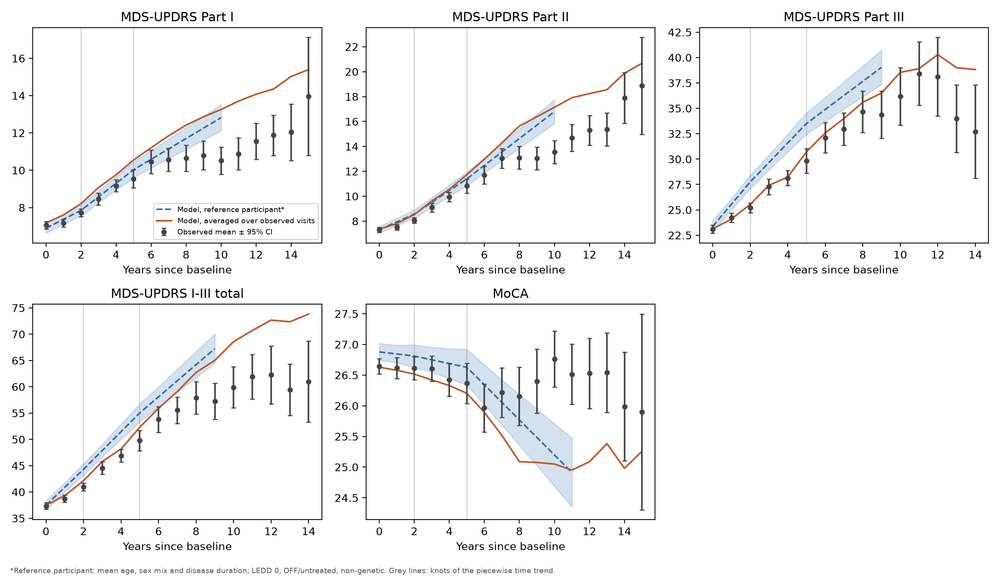
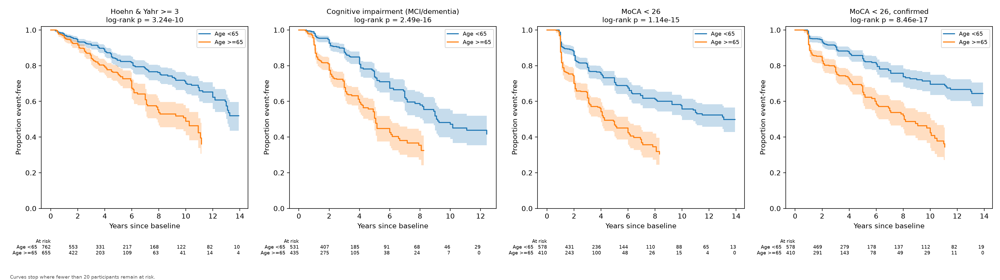
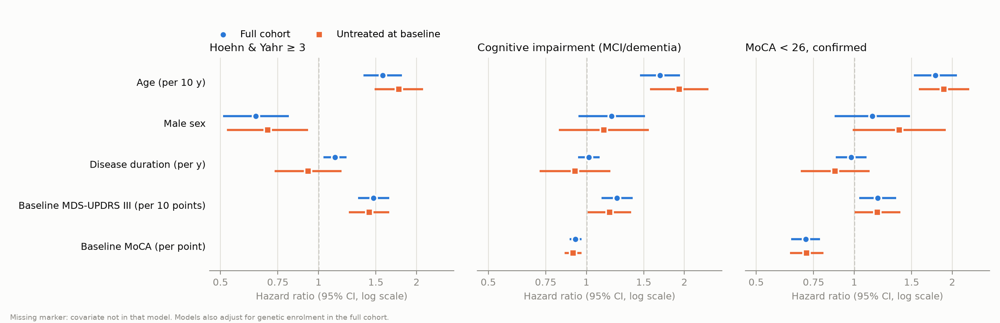

# Progression of Parkinson's disease in PPMI: mixed-effects and survival models

[](https://github.com/barbavegeta/ppmi-progression/actions/workflows/tests.yml)

How fast do motor, daily-living and cognitive scores change in early Parkinson's disease, and who reaches
disability and cognitive milestones first? Mixed-effects and Cox models of 1,789 participants (13,412 visits,
median follow-up 3.1 years) from the Parkinson's Progression Markers Initiative (PPMI), with the main modelling
assumptions checked.

**Findings**

- Medication-adjusted motor progression (MDS-UPDRS III) is fastest early, about 2.0 points a year, and slows to 1.2 after five years.
- Daily-living impact (Part II) does the opposite and accelerates.
- MoCA is flat for about five years, then falls by about 0.2 points a year.
- Age is the strongest predictor of Hoehn & Yahr 3 and of cognitive impairment (HR about 1.6-1.8 per decade).
- A third of participants were treated at baseline; the results hold in the 1,171 who were not.

Write-up: [barbavegeta.github.io/projects/ppmi-progression.html](https://barbavegeta.github.io/projects/ppmi-progression.html)

## Results



Change per year from the piecewise mixed models (95% CI). A straight-line trend was rejected for every outcome (LR p from 0.01 to 1e-16).

| Outcome | 0-2 years | 2-5 years | After 5 years |
|---|---|---|---|
| MDS-UPDRS I | 0.39 (0.27-0.52) | 0.64 (0.52-0.76) | 0.47 (0.37-0.58) |
| MDS-UPDRS II | 0.50 (0.34-0.66) | 0.82 (0.66-0.97) | 0.95 (0.81-1.10) |
| MDS-UPDRS III | 2.00 (1.67-2.33) | 1.73 (1.41-2.05) | 1.19 (0.89-1.50) |
| MDS-UPDRS I-III | 3.02 (2.52-3.53) | 3.20 (2.70-3.70) | 2.67 (2.20-3.15) |
| MoCA | 0.03 (-0.06 to 0.12) | 0.00 (-0.09 to 0.09) | -0.23 (-0.30 to -0.15) |



Cox hazard ratios (95% CI), also adjusted for disease duration and genetic enrolment.

| | H&Y >= 3 | Cognitive impairment | MoCA < 26, confirmed |
|---|---|---|---|
| Events / participants | 299 / 1,417 | 311 / 966 | 260 / 988 |
| Age, per 10 years | 1.58 (1.37-1.80) | 1.68 (1.46-1.94) | 1.78 (1.52-2.07) |
| Male sex | 0.64 (0.51-0.81) | 1.20 (0.95-1.51) | 1.14 (0.87-1.49) |
| Baseline MDS-UPDRS III, per 10 points | 1.48 (1.32-1.65) | 1.24 (1.11-1.39) | 1.18 (1.04-1.35) |
| Baseline MoCA, per point | - | 0.93 (0.89-0.97) | 0.71 (0.64-0.79) |

## Model checks

**Shape of the time trend.** Likelihood-ratio tests (ML fits, 2 df) of piecewise against linear time:
Part I p = 0.002, Part II p = 3e-13, Part III p = 3e-9, I-III total p = 0.01, MoCA p = 8e-17.

**Proportional hazards.** Of 23 covariate tests, 4 had p < 0.05. Those covariates were refitted with separate hazard ratios before and after year 3:

| Milestone | Covariate | HR 0-3 y | HR > 3 y | p (equal) |
|---|---|---|---|---|
| H&Y >= 3 | Male sex | 0.50 (0.36-0.71) | 0.79 (0.57-1.08) | 0.06 |
| Cognitive impairment | Age, per 10 years | 1.88 (1.56-2.26) | 1.45 (1.18-1.79) | 0.07 |
| Cognitive impairment | Disease duration, per year | 1.04 (0.94-1.15) | 1.00 (0.91-1.10) | 0.52 |
| MoCA < 26, confirmed | Baseline MoCA, per point | 0.63 (0.54-0.73) | 0.81 (0.70-0.93) | 0.02 |

Effects weaken over time but never change direction.

**Event timing.** Milestones are only seen at visits. Placing each event midway between the last negative and first positive visit changes no hazard ratio for age, sex, baseline MDS-UPDRS III or baseline MoCA by more than 0.04.

**Dropout.** Pattern-mixture slopes by length of follow-up (Part III, points per year): 2.77 (1.83-3.70) with under 2 years, 1.69 (1.36-2.03) with 2-5 years, 1.60 (1.31-1.88) with 5 or more. People who leave early were progressing faster, so the missing-at-random estimates are likely conservative.

**Treatment at baseline.** Every model was re-run on the 1,171 participants untreated at baseline. The hazard ratios for age, sex, motor and cognitive severity hold; the apparent effect of disease duration on H&Y >= 3 does not, so it reflects the treated, longer-diagnosed participants.



## Methods

| Step | File | Method |
|---|---|---|
| Load and clean | `load.py` | Merges MDS-UPDRS I-III, MoCA, cognitive categorisation, demographics, diagnosis history and the LEDD log into one row per participant per scheduled visit (BL, V##). |
| Trajectories | `models_lmm.py` | Linear mixed-effects models for MDS-UPDRS I, II, III, I-III total and MoCA, with a random intercept and slope per participant. Adjusted for baseline age, sex and disease duration (each interacted with time), time-varying LEDD, Part III medication state and genetic enrolment. A piecewise-linear version (knots at 2 and 5 years, `TIME_KNOTS`) gives the annual change in each period and is tested against the linear model with a likelihood-ratio test on ML fits. A pattern-mixture sensitivity analysis estimates the slope separately by length of follow-up. |
| Milestones | `models_survival.py` | Kaplan-Meier curves and Cox models for time to Hoehn & Yahr >= 3, cognitive impairment (MCI or dementia), MoCA < 26, and MoCA < 26 confirmed at the next assessed visit (removes single-visit dips near the cut-off; a drop at the last visit counts unless `MOCA_CONFIRM_LAST_VISIT = False`). Includes Schoenfeld-type proportional-hazards tests, plus a sensitivity analysis that places each event at the midpoint between the last negative and first positive visit. |
| Robustness figure | `plot_forest.py` | Forest plot of Cox hazard ratios in the full cohort against participants untreated at baseline. |
| Orchestration | `run_all.py` | Runs everything, then repeats all models on participants untreated at baseline (`output/sensitivity_untreated_bl/`). |
| Data checks | `check_files.py`, `check_ledd.py` | Which PPMI files and columns were found; aggregate checks on the LEDD log. Neither prints participant-level values. |
| Synthetic data | `make_synthetic_data.py` | Fake data in the PPMI file layout, for trying the pipeline and for the tests. |

Analysis decisions:
- **Part III:** when a visit has both OFF and ON exams, the OFF (or untreated) exam is used. The state of the exam kept is included as a covariate.
- **Time:** months since baseline, computed from each visit's month/year (`INFODT`).
- **LEDD:** summed over the medications active in the visit month, following the PPMI LEDD method. COMT-inhibitor rows (`LD x 0.33`) are applied to that visit's levodopa dose.
- **Baseline MoCA:** PPMI often gives it at the screening visit (SC). If BL has no MoCA, the SC score is used when SC is at most `MOCA_SC_MAX_MONTHS` (6) before baseline.
- **Cox models:** complete cases on the covariates; `survival_counts.csv` reports the N and events actually used. A binary covariate with no events in one level is dropped from that model.
- **Trajectory figure:** the dashed line is a reference participant (mean age, sex mix and duration; LEDD 0, OFF/untreated, non-genetic). The solid line averages the model's predictions over the visits actually observed, so it is the like-for-like comparison with the observed means.
- **Non-proportional hazards:** covariates whose PH test gives p < `PH_ALPHA` (0.05) are refitted with separate hazard ratios for 0-3 and >3 years (`COX_TIME_SPLIT`) in a counting-process Cox model, with a Wald test that the two HRs are equal (`cox_hazard_ratios_time_split.csv`).
- **Kaplan-Meier plots:** curves stop where fewer than `KM_MIN_AT_RISK` (20) participants remain at risk, and the number at risk is shown under each panel.
- **LEDD log cleaning:** exact duplicate rows are dropped, and in a month where a drug's dose changes only the new row counts (month-only dates would otherwise credit both doses).
- **Baseline treatment:** about a third of the PD cohort (90% of genetic enrolees) is on dopaminergic treatment at baseline, so this is not a purely de novo cohort. All models are re-run on participants untreated at baseline (LEDD 0 and an untreated Part III exam) in `output/sensitivity_untreated_bl/`.
- **Out-of-range scores:** scores outside the valid range, such as 101 ("unable to rate"), are set to missing.

## Run it

Tested on Python 3.12 (CI) and 3.14.

Running on real data needs your own PPMI account (registration and acceptance of the PPMI Data Use
Agreement). The synthetic-data route below needs nothing.

```bash
python -m venv .venv
.venv\Scripts\activate          # Windows
source .venv/bin/activate       # macOS / Linux
pip install -r requirements.txt

# 1. Put the PPMI CSV downloads in data/raw/
# 2. Check the files and columns (prints file and column names only)
python check_files.py
# 3. Run everything
python run_all.py
# Optional: aggregate checks on the LEDD log (ledd_check.csv)
python check_ledd.py
```

Results are written to `output/tables/` (CSV) and `output/figures/` (PNG).

To try the pipeline without PPMI access, generate fake data in the same layout:

```bash
python make_synthetic_data.py
python run_all.py --data-dir data/synthetic --out-dir output_synthetic
```

## Tests

`pytest` runs 18 tests, also on every push via GitHub Actions. None needs PPMI data.

- **Data cleaning** (`tests/test_load.py`): date parsing, out-of-range codes, and the LEDD rules (dose-change months, duplicate rows, concurrent prescriptions, COMT multipliers).
- **Milestones** (`tests/test_survival.py`): single-visit and confirmed MoCA < 26 on hand-built participants, the counting-process split, the Kaplan-Meier cut-off, and a simulation in which the time-split Cox model recovers a hazard ratio of 2 before year 3 and 1 after.
- **Trajectories** (`tests/test_lmm.py`): the piecewise contrasts, and a simulation in which the mixed model recovers known slopes of 2.0, 1.0 and 0.3 points a year.
- **End to end** (`tests/test_pipeline.py`): generates synthetic data and runs the whole pipeline, including the untreated-at-baseline sensitivity analysis.

## Data use

Data used in the preparation of this article was obtained on 2026-10-06 from the Parkinson's
Progression Markers Initiative (PPMI) database (www.ppmi-info.org/access-data-specimens/download-data),
RRID:SCR_006431. For up-to-date information on the study, visit www.ppmi-info.org.

PPMI – a public-private partnership – is funded by the Michael J. Fox Foundation for Parkinson's
Research, and funding partners; including Abbvie, Alamar Biosciences, Aligning Science Across Parkinson's, Arrowhead Pharma, Arvinas, AskBio, BIAL, BioArctic, Biohaven, BlueRock Therapeutics, Bristol-Myers Squibb, Calico Labs, Capsida Biotherapeutics, Critical Path Institute, DaCapo Brainscience, Denali, Edmond J. Safra Foundation, Eli Lilly, Gain Therapeutics, GE HealthCare, Genentech, GSK, Insitro, Johnson & Johnson Innovative Medicine, Lundbeck, Merck, Neumora, Neuron23, Novartis, Olink, Regeneron, Roche, Sanofi, Tenvie, UCB, VanquaBio, Voyager Therapeutics, the Weston Family Foundation.

This analysis used PPMI Tier 1 data, available to registered users who accept the PPMI Data Use Agreement.

This repository contains code and aggregate figures only. No PPMI data, and no
participant-level output, are included or may be committed. `output/derived/` holds a
participant-level file for local checks only. `docs/figures/` holds copies of the
aggregate figures from `output/figures/`.

## Limitations

- Milestones are only observed at visits, so event times are interval censored.
  The Cox models treat them as right censored, and the midpoint sensitivity
  analysis shows how much this matters.
- The mixed models assume data are missing at random. Dropout in PD is likely
  informative; the pattern-mixture analysis is a check, not a fix.
- Death is not modelled as a competing risk.
- MoCA has a ceiling effect, and its total is not adjusted for education.
- In the piecewise models the mean trend changes slope at 2 and 5 years, but each participant's
  random slope is a single line over the whole follow-up.
- About a third of participants were treated at baseline, so this is not a purely de novo cohort;
  the untreated-at-baseline analysis addresses this.

## Licence

Code: MIT (see `LICENSE`). PPMI data are covered by the PPMI Data Use Agreement, not by this licence.
